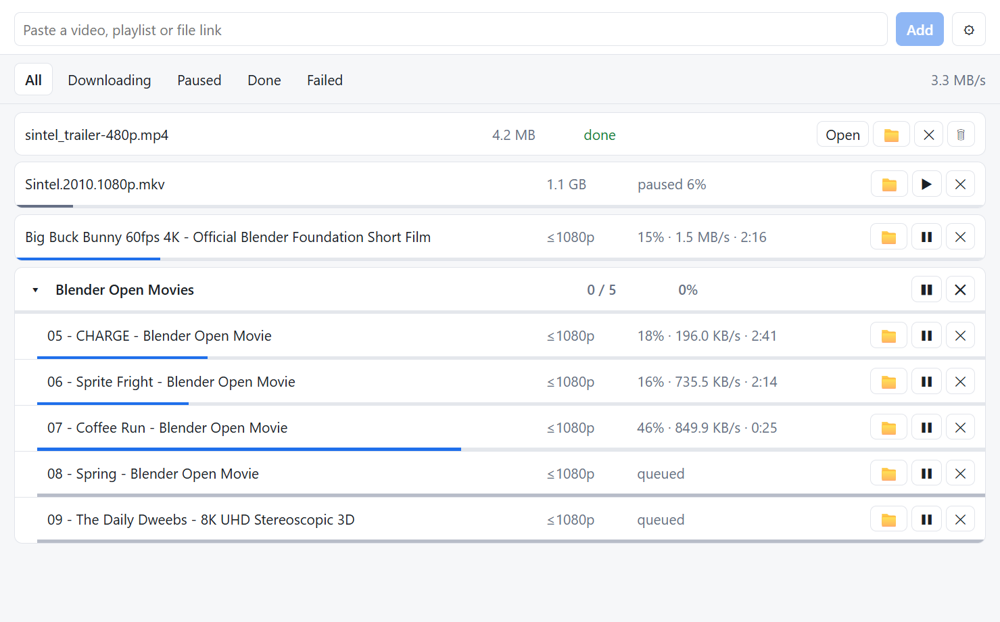
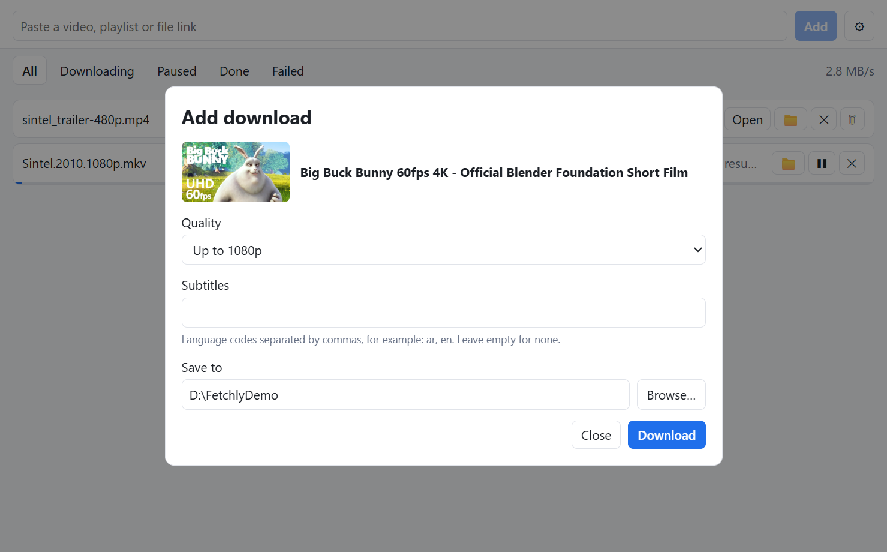
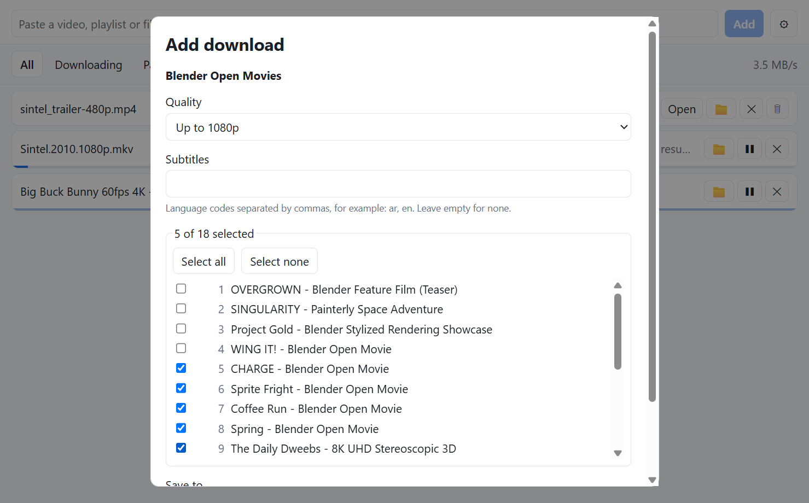
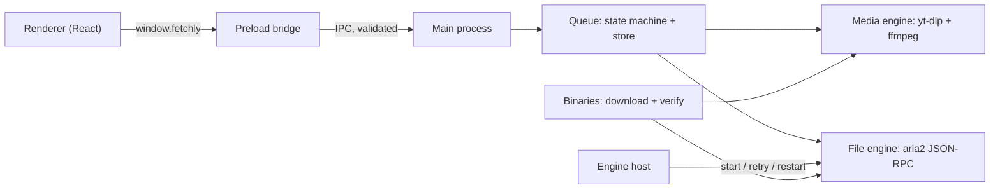

# Fetchly

[](https://github.com/YoussefRashad/fetchly/actions/workflows/ci.yml)

A download manager for Windows, built with Electron, React and TypeScript.
Paste a link and Fetchly downloads a video, a whole playlist, or any direct
file (PDF, zip, video file), with a choice of quality and pause/resume that
survives closing the app or restarting the PC.



Fetchly is a window, a queue and a process supervisor around three free
tools that do the transfer work:

| Tool | Job |
| --- | --- |
| [yt-dlp](https://github.com/yt-dlp/yt-dlp) | reads video sites and downloads the streams |
| [ffmpeg](https://github.com/yt-dlp/FFmpeg-Builds) | joins video and audio into one file |
| [aria2](https://github.com/aria2/aria2) | downloads ordinary files over several connections |

Protected (DRM) content is out of scope: Fetchly never tries to decrypt it
and lists such items as `skipped: protected`.

## Features

- **Videos and playlists.** Probe a link, pick a quality (by height, or audio
  only), choose which playlist items to keep, and download them into one
  folder, numbered in playlist order.
- **Direct files.** Any HTTP(S) file link goes to aria2 with several
  connections per download.
- **Pause, resume, cancel and retry** for a single download or a whole
  playlist. Partial data is kept, and an interrupted download continues
  after a crash or a reboot.
- **A global speed limit**, shared across the running downloads and applied
  to them without losing progress.
- **Tray app.** Closing the window keeps downloads running; the tray tooltip
  shows how many are active.
- **English or Arabic, light or dark.** Both follow Windows unless set in
  Settings; Arabic is laid out right to left. Each download shows how much has
  arrived and, when known, its size (for a video, the size of the stream being
  downloaded, marked `~`).
- **One-time setup** that fetches the three tools from their official
  release pages and verifies them by checksum, plus an in-app yt-dlp update
  for when a site changes.
- **No silent failures.** Every failed or skipped item says why, and banners
  explain engine, save and cut-off-download problems with a button to fix
  them.

## Screenshots

| Pick a quality for a video | Pick which playlist items to keep |
| --- | --- |
|  |  |

Shown: Blender Foundation open movies (CC BY), downloaded with the real
tools. The main view above has a direct file done, a 1.1 GB direct file
paused, a video downloading and a five-item playlist in progress.

## Engineering highlights

- **Explicit job state machine** (`src/main/jobs/state.ts`): every allowed
  transition is in one table; anything else throws `IllegalTransition`
  instead of being silently ignored.
- **Crash-safe persistence** (`src/main/jobs/store.ts`): the job list is
  written to a temp file, flushed to disk and renamed over the old one. Loading
  is strict: each field is validated (`validate.ts`), a damaged file is moved
  aside and reported, and downloads that were running at a crash come back
  as paused.
- **Confirmed process stops.** Pause and quit wait until yt-dlp, ffmpeg or
  aria2 has really exited before a job counts as paused, so no partial file
  is ever written by two processes. Leftover processes from a crash are found
  by executable path and ended at start; if that check cannot run, resume is
  refused until the user confirms they are gone.
- **Single-flight engine host** (`src/main/engineHost.ts`,
  `src/main/queueLifecycle.ts`): start, retry and restart of the aria2 daemon
  share one in-flight run, and the queue is created, wired and disposed in
  one owned order, so a failure at any step leaves no orphaned engine.
- **Verified tool installs** (`src/main/binaries.ts`): archives are checked
  against published SHA-256 sums (aria2 against a pinned one) before
  anything is extracted, and installs are serialized.
- **Safe with what it downloads** (`src/main/fileSafety.ts`): every finished
  file carries the Windows Mark-of-the-Web (`Zone.Identifier`, zone 3), so
  SmartScreen and Office Protected View still apply; opening a program,
  shortcut, script or disk image asks first; and aria2 is limited to plain
  HTTP(S), so a link to a `.torrent` or metalink is saved, never followed.
- **Locked-down renderer.** The window runs sandboxed with context isolation
  and no Node integration. It only sees the typed `window.fetchly` bridge
  (`src/preload`), and every argument that crosses IPC is validated in the
  main process (`src/main/ipc.ts`).
- **Tested without the network.** Over 2,600 Vitest tests run in about 15
  seconds, using a scripted stand-in for yt-dlp and an in-process aria2
  JSON-RPC stand-in. What only real sites can prove is in a
  [manual checklist](docs/manual-checklist-phase1.md).

## Architecture



## Run it

Requires Windows and Node.js 22 or newer.

```powershell
npm install
```

```powershell
npm run dev
```

If the app refuses to start with "Electron uninstall", the Electron runtime
was not fetched during `npm install`. Fetch it once:

```powershell
node node_modules/electron/install.js
```

On first start the app shows a one-time setup screen and downloads the three
tools from their official GitHub release pages. yt-dlp and ffmpeg are checked
against the checksums published with each release. aria2 publishes none, so
its checksum is pinned in `src/main/binaries.ts` (`ARIA2_ZIP_SHA256`) and the
download is checked against that value; an empty value would make the setup
refuse to install aria2.

A build that runs without the dev server:

```powershell
npm run build
```

```powershell
npm start
```

Windows SmartScreen may warn the first time, because the app is not signed.

## Where things live

| What | Where |
| --- | --- |
| Downloads | `Downloads\Fetchly` (change it in Settings) |
| Download list and settings | `%APPDATA%\fetchly\jobs.json`, `settings.json` |
| The three tools | `%APPDATA%\fetchly\bin` |

`%APPDATA%\fetchly\bin` belongs to the app alone. At start Fetchly ends every
yt-dlp, ffmpeg or aria2c process running from that folder. Do not start these
copies by hand.

Closing the window keeps downloads running; the app lives in the tray, and
**Quit** is in the tray menu.

## Develop

```powershell
npm run typecheck
```

```powershell
npm run lint
```

```powershell
npm test
```

The tests use no external network and no real tools; some start a server on
127.0.0.1 and talk to it. `tests/fakes` holds the yt-dlp and aria2 stand-ins.
CI runs typecheck, lint, the tests and a build on Windows for every push and
pull request.

`npm run e2e:real -- 2 13` (or `all`) drives the built app (`npm run build` first) through the
manual checklist with Playwright, on a scratch profile in `.e2e-real/`. It is opt-in, uses the
network and the real tools, and never runs in CI; the last results are in
[docs/manual-checklist-phase1-results.md](docs/manual-checklist-phase1-results.md).

Design: [docs/superpowers/specs/2026-11-22-download-manager-design.md](docs/superpowers/specs/2026-11-22-download-manager-design.md).
It was written under the working name Hammel; the dated plans in
`docs/superpowers` keep that name as history.

## Layout

```
src/shared/types.ts      types used by both sides
src/main/jobs/           state machine, persistence, validation, queue
src/main/engines/        yt-dlp and aria2 supervision
src/main/ytdlp/          argument building and output parsing
src/main/engineHost.ts   aria2 daemon start, retry and restart
src/main/binaries.ts     fetch and verify the tools
src/main/fileSafety.ts   Mark-of-the-Web and runnable-file checks
src/main/ipc.ts          what the window may ask for
src/preload/             the bridge exposed as window.fetchly
src/renderer/            the window (React)
tests/                   Vitest specs and the fake tools
```

## Roadmap

Phase 1, the desktop app, is done. Planned next:

- A Chrome/Edge extension that adds a download button on videos and a
  "Download with Fetchly" link menu, handing the URL to the app.
- Course playlists, and courses the user has bought on login-gated sites,
  using the user's own browser session (best effort).

## License

[MIT](LICENSE). yt-dlp, ffmpeg and aria2 are separate programs under their
own licenses; Fetchly downloads them from their official releases and does
not bundle them.
