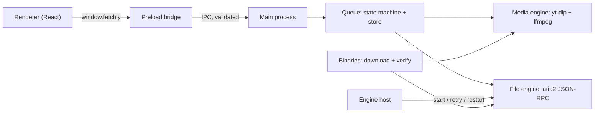

# Fetchly

[](https://github.com/YoussefRashad/fetchly/actions/workflows/ci.yml)

A download manager for Windows, built with Electron, React and TypeScript.
Paste a link and Fetchly downloads a video, a whole playlist, or any direct
file (PDF, zip, video file), with a choice of quality and pause/resume that
survives closing the app or restarting the PC.


Fetchly is a window, a queue and a process supervisor around three free
tools that do the transfer work:

| Tool | Job |
| --- | --- |
| [yt-dlp](https://github.com/yt-dlp/yt-dlp) | reads video sites and downloads the streams |
| [ffmpeg](https://github.com/yt-dlp/FFmpeg-Builds) | joins video and audio into one file |
| [aria2](https://github.com/aria2/aria2) | downloads ordinary files over several connections |

Protected (DRM) content is out of scope: Fetchly never tries to decrypt it
and lists such items as `skipped: protected`.

## Features

- **Videos and playlists.** Probe a link, pick a quality (by height, or audio
  only), choose which playlist items to keep, and download them into one
  folder, numbered in playlist order.
- **Direct files.** Any HTTP(S) file link goes to aria2 with several
  connections per download.
- **Pause, resume, cancel and retry** for a single download or a whole
  playlist. Partial data is kept, and an interrupted download continues
  after a crash or a reboot.
- **A global speed limit**, shared across the running downloads and applied
  to them without losing progress.
- **Tray app.** Closing the window keeps downloads running; the tray tooltip
  shows how many are active.
- **English or Arabic, light or dark.** Both follow Windows unless set in
  Settings; Arabic is laid out right to left. Each download shows how much has
  arrived and, when known, its size (for a video, the size of the stream being
  downloaded, marked `~`).
- **One-time setup** that fetches the three tools from their official
  release pages and verifies them by checksum, plus an in-app yt-dlp update
  for when a site changes.
- **No silent failures.** Every failed or skipped item says why, and banners
  explain engine, save and cut-off-download problems with a button to fix
  them.

## Screenshots

| Pick a quality for a video | Pick which playlist items to keep |
| --- | --- |
|  |  |

Shown: Blender Foundation open movies (CC BY), downloaded with the real
tools. The main view above has a direct file done, a 1.1 GB direct file
paused, a video downloading and a five-item playlist in progress.

## Engineering highlights

- **Explicit job state machine** (`src/main/jobs/state.ts`): every allowed
  transition is in one table; anything else throws `IllegalTransition`
  instead of being silently ignored.
- **Crash-safe persistence** (`src/main/jobs/store.ts`): the job list is
  written to a temp file, flushed to disk and renamed over the old one. Loading
  is strict: each field is validated (`validate.ts`), a damaged file is moved
  aside and reported, and downloads that were running at a crash come back
  as paused.
- **Confirmed process stops.** Pause and quit wait until yt-dlp, ffmpeg or
  aria2 has really exited before a job counts as paused, so no partial file
  is ever written by two processes. Leftover processes from a crash are found
  by executable path and ended at start; if that check cannot run, resume is
  refused until the user confirms they are gone.
- **Single-flight engine host** (`src/main/engineHost.ts`,
  `src/main/queueLifecycle.ts`): start, retry and restart of the aria2 daemon
  share one in-flight run, and the queue is created, wired and disposed in
  one owned order, so a failure at any step leaves no orphaned engine.
- **Verified tool installs** (`src/main/binaries.ts`): archives are checked
  against published SHA-256 sums (aria2 against a pinned one) before
  anything is extracted, and installs are serialized.
- **Safe with what it downloads** (`src/main/fileSafety.ts`): every finished
  file carries the Windows Mark-of-the-Web (`Zone.Identifier`, zone 3), so
  SmartScreen and Office Protected View still apply; opening a program,
  shortcut, script or disk image asks first; and aria2 is limited to plain
  HTTP(S), so a link to a `.torrent` or metalink is saved, never followed.
- **Locked-down renderer.** The window runs sandboxed with context isolation
  and no Node integration. It only sees the typed `window.fetchly` bridge
  (`src/preload`), and every argument that crosses IPC is validated in the
  main process (`src/main/ipc.ts`).
- **Tested without the network.** Over 2,600 Vitest tests run in about 15
  seconds, using a scripted stand-in for yt-dlp and an in-process aria2
  JSON-RPC stand-in. What only real sites can prove is in a
  [manual checklist](docs/manual-checklist-phase1.md).

## Architecture



## Run it

Requires Windows and Node.js 22 or newer.

```powershell
npm install
```

```powershell
npm run dev
```

If the app refuses to start with "Electron uninstall", the Electron runtime
was not fetched during `npm install`. Fetch it once:

```powershell
node node_modules/electron/install.js
```

On first start the app shows a one-time setup screen and downloads the three
tools from their official GitHub release pages. yt-dlp and ffmpeg are checked
against the checksums published with each release. aria2 publishes none, so
its checksum is pinned in `src/main/binaries.ts` (`ARIA2_ZIP_SHA256`) and the
download is checked against that value; an empty value would make the setup
refuse to install aria2.

A build that runs without the dev server:

```powershell
npm run build
```

```powershell
npm start
```

Windows SmartScreen may warn the first time, because the app is not signed.

## Build a portable exe

```powershell
npm run dist:portable
```

This builds the app and packs it with electron-builder into one file,
`dist\Fetchly-<version>-portable-x64.exe`, that runs without installing.
Copy it anywhere and double-click it. Each start unpacks the app to a
temporary folder first, so it opens a few seconds slower than an installed
app. The exe is not signed, so SmartScreen may warn. Its icon is drawn by
`scripts/app-icon.mjs` during the build, so the repository holds no image file
for it.

The portable exe keeps its data where the other builds do, in
`%APPDATA%\fetchly` (see the table below), not next to the exe. Moving or
deleting the exe leaves the download list, settings, pairings and the three
tools in place; delete that folder to remove them.

## Where things live

| What | Where |
| --- | --- |
| Downloads | `Downloads\Fetchly` (change it in Settings) |
| Download list and settings | `%APPDATA%\fetchly\jobs.json`, `settings.json` |
| Paired browsers | `%APPDATA%\fetchly\pairing.json` |
| The three tools | `%APPDATA%\fetchly\bin` |

`%APPDATA%\fetchly\bin` belongs to the app alone. At start Fetchly ends every
yt-dlp, ffmpeg or aria2c process running from that folder. Do not start these
copies by hand.

Closing the window keeps downloads running; the app lives in the tray, and
**Quit** is in the tray menu.

## Browser connection

For the browser extension, the app listens on `127.0.0.1` only,
on port 38917 by default. **Settings → Browser connection port** changes it to
any port from 1024 to 65535. A browser is paired once: **Settings → Browser →
Pair a browser** shows a one-time `<port>-<code>` string, valid for 5 minutes,
that is typed into the extension. Up to four browsers can be paired, each with
its own token; **Unpair** revokes one at once.

- **Changing the port means pairing again.** The port is part of every
  pairing, so saving a new port removes all pairings after a confirmation.
- If the port is taken by another program, a banner says so and pairing is
  off; choose another port, or free it and save Settings again.
- `pairing.json` holds values derived from each browser's token (never the
  token itself). It sits in the roaming profile, which sync and backups copy.
  A `pairing.json.corrupt-*` file (an unreadable list set aside at start) and a
  leftover `pairing.json.tmp` hold the same key material: delete them by hand
  when you no longer need them.
- **Same-user limit:** any program running as your Windows user can read
  `pairing.json` and the extension's storage. That is not defended.
- If a pairing change cannot be written to disk, Fetchly keeps it in memory,
  says so in Settings, and retries every 30 s and at quit. Until a write
  succeeds, a restart shows the old list, so an unpaired browser can return.

### The extension (Chrome and Edge)

The extension is not in a web store; it is built and loaded unpacked:

```powershell
npm run build:ext
```

Then open `chrome://extensions` (or `edge://extensions`), turn on
**Developer mode**, press **Load unpacked** and choose the `extension\dist`
folder. Open the Fetchly icon's popup, type the pairing string from
**Settings → Browser → Pair a browser**, and press **Pair**.

- The extension asks for no permission except access to `http://127.0.0.1`.
  It does not use the browser's extension storage: the pairing (the port and
  the token) is kept in the extension's own IndexedDB, which web pages and
  other extensions cannot open.
- **Moving the `extension` folder, or changing the port in Fetchly, means
  pairing again.** A moved folder is a new extension with an empty store; the
  popup then says "Not paired". After a port change it says Fetchly is not
  running, with a hint to pair again.
- **Same-user limit:** the token sits in the browser profile, so any program
  running as your Windows user can read it. That is not defended.
- The popup follows the browser's language (Arabic or English); there is no
  language switch.
- A browser entry that no longer works (a moved folder, a removed extension)
  stays in Fetchly's list until you remove it in **Settings → Browser**. When
  a new pairing replaces an old one, the extension removes the old entry itself
  after the first successful connection. The old entry may remain if that check
  or the removal fails, if the browser stops the extension first, or if saving
  the pairing failed; remove it the same way.
- If the popup keeps saying "Another operation is running" (بالعربي: «عملية أخرى قيد التنفيذ»),
  an earlier step is stuck. Turn the extension off and on in the
  browser's extensions page, then open the popup again.

## Develop

```powershell
npm run typecheck
```

```powershell
npm run lint
```

```powershell
npm test
```

```powershell
npm run build:ext
```

The tests use no external network and no real tools; some start a server on
127.0.0.1 and talk to it. `tests/fakes` holds the yt-dlp, aria2 and browser
stand-ins. CI runs typecheck, lint, the tests, the app build and the
extension build on Windows for every push and pull request.

`npm run e2e:real -- 2 13` (or `all`) drives the built app (`npm run build` first) through the
manual checklist with Playwright, on a scratch profile in `.e2e-real/`. It is opt-in, uses the
network and the real tools, and never runs in CI; the last results are in
[docs/manual-checklist-phase1-results.md](docs/manual-checklist-phase1-results.md).

Design: [docs/superpowers/specs/2026-11-22-download-manager-design.md](docs/superpowers/specs/2026-11-22-download-manager-design.md).
It was written under the working name Hammel; the dated plans in
`docs/superpowers` keep that name as history.

## Layout

```
src/shared/types.ts      types used by both sides
src/shared/protocol.ts   the browser wire protocol: limits, formats, error tokens
src/main/server/         local server for the browser: listener, routes, pairing
src/main/jobs/           state machine, persistence, validation, queue
src/main/engines/        yt-dlp and aria2 supervision
src/main/ytdlp/          argument building and output parsing
src/main/engineHost.ts   aria2 daemon start, retry and restart
src/main/binaries.ts     fetch and verify the tools
src/main/fileSafety.ts   Mark-of-the-Web and runnable-file checks
src/main/ipc.ts          what the window may ask for
src/preload/             the bridge exposed as window.fetchly
src/renderer/            the window (React)
extension/               the Chrome/Edge extension (MV3): popup and service worker
tests/                   Vitest specs and the fake tools
scripts/app-icon.mjs     draws the exe icon for the portable build
electron-builder.yml     packager config for npm run dist:portable
```

## Roadmap

Phase 1, the desktop app, is done. Planned next:

- A Chrome/Edge extension that adds a download button on videos and a
  "Download with Fetchly" link menu, handing the URL to the app.
- Course playlists, and courses the user has bought on login-gated sites,
  using the user's own browser session (best effort).

## License

[MIT](LICENSE). yt-dlp, ffmpeg and aria2 are separate programs under their
own licenses; Fetchly downloads them from their official releases and does
not bundle them.
